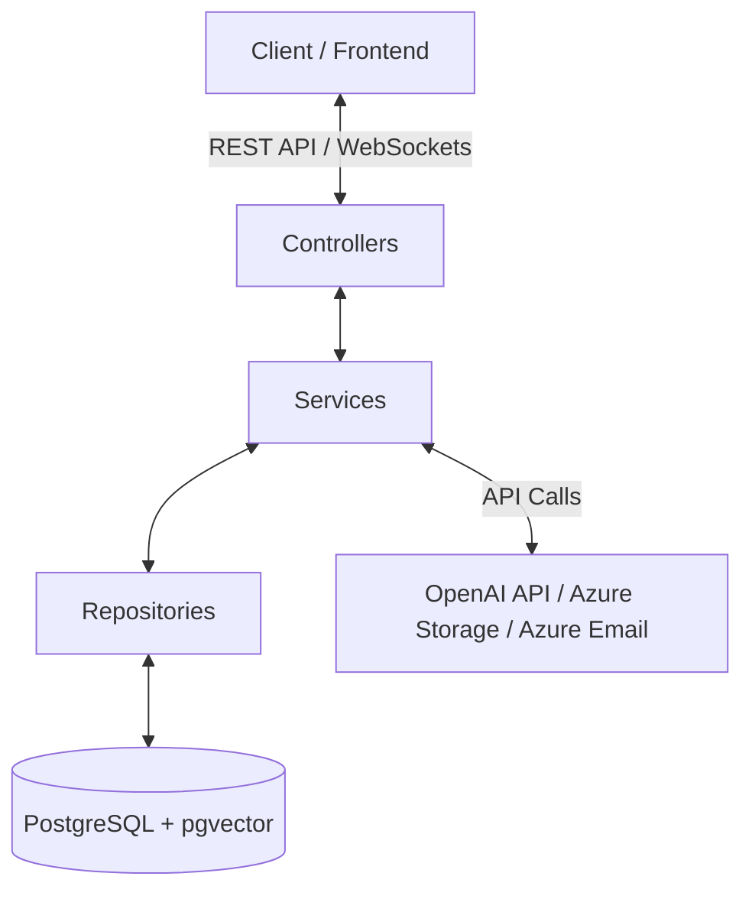

# Helpdesk Backend Codebase Analysis Report

This document presents a comprehensive technical analysis of the `helpdesk-backend` codebase. The project is a modern, AI-augmented, event-driven Helpdesk ticketing system built on top of **Spring Boot 3.5.14** and **Java 17**.

---

## 1. Architectural Overview

The backend follows a standard N-tier architecture comprising Controllers, Services, Entities, Repositories, DTOs, Mappers, and Config modules:

### Core Technologies
- **Spring Boot 3.5.14** & **Java 17**
- **PostgreSQL** with **pgvector** extension (for AI semantic search & matching)
- **Hibernate / JPA** (for Object-Relational Mapping)
- **Flyway** (for database migrations)
- **Lombok** (boilerplate reduction)
- **Spring Security + JWT** (Authentication & Role-Based Access Control)
- **Spring WebSocket** (Real-time client notifications & replies)
- **Azure Blob Storage** (Ticket attachment management)
- **Azure Communication Email Service** (Transactional emails)
- **OpenAI API** (embeddings via `text-embedding-3-small` and chat completions via `gpt-4o-mini`)

---

## 2. Database Schema (Flyway Migrations)

The database schema is managed via Flyway migrations located in `src/main/resources/db/migration`:

| Migration File | Purpose | Main Schema Changes |
| :--- | :--- | :--- |
| `V1__create_users_table.sql` | Users | Creates `users` table with id, name, email, password, role, is_active, created_at |
| `V2__change_user_role_to_varchar.sql` | User role fix | Migrates role to a simple VARCHAR representation |
| `V3__create_tickets_table.sql` | Categories & Tickets | Creates `categories` & `tickets` table with constraints & triggers for auto-updating timestamps |
| `V4__add_user_category.sql` | Agent categorization | Links users to category table (primarily for routing agent expertise) |
| `V5__create_replies_table.sql` | Ticket conversation thread | Creates `replies` table (supporting internal vs public and AI-generated messages) |
| `V6__create_notifications_table.sql` | Notifications | Creates `notifications` table for tracking read/unread user notifications |
| `V7__add_embeddings.sql` | Vector Support | Installs **pgvector** extension. Adds `vector(1536)` columns to `tickets` and `knowledge_articles` with `ivfflat` vector indexes |
| `V8__create_ratings_table.sql.sql` | Customer satisfaction ratings | Creates `ratings` table linking one-to-one to tickets |
| `V9__add_knowledge_article_updated_at.sql` | Knowledge base tracking | Adds `updated_at` to `knowledge_articles` |
| `V10__create_ticket_links_table.sql` | Linked tickets | Creates `ticket_links` junction table for managing relations between tickets |
| `V11__create_attachments_table.sql` | File attachments | Creates `attachments` table linking files to tickets/replies |

---

## 3. Key Feature Domain Breakdown

### A. Authentication & Security
- **Endpoints**: `/api/auth/register`, `/api/auth/login` (Permitted without authentication).
- **Implementation**: Uses JWT tokens. `SecurityConfig` runs `JwtFilter` before standard authentication filters to load `UserDetails`.
- **Roles**:
  - `USER`: Submits tickets, views their own tickets, reopens solved tickets, rates resolved tickets, views published knowledge articles.
  - `AGENT`: Assigned to tickets based on `Category` load-balancing. Can post public/internal replies, draft knowledge articles, link tickets, and request AI assistance.
  - `ADMIN`: Has full override control. Manages categories, agents, registers new agent accounts, and publishes/unpublishes knowledge base drafts.

### B. Tickets & Automated Assignment (`AssignmentService`)
- When a user submits a ticket:
  - If a `category` is assigned, `AssignmentService.autoAssign` kicks in.
  - It fetches the **least loaded active agent** assigned to that category (`UserRepository.findLeastLoadedAgentByCategory`) using a database count of open/in-progress tickets and assigns it immediately.
  - Pushes real-time WebSocket notifications to the agent.

### C. AI Engine & Semantic Capabilities (`AIService`, `EmbeddingService`)
This is the core differentiator of the Helpdesk system:
1. **Auto-Resolution**:
   - When a ticket is created, it is embedded using OpenAI's `text-embedding-3-small` (1536 dimensions).
   - The backend runs a PostgreSQL cosine similarity query (`SimilarTicketRepository.findSimilarResolvedTickets` / `findSimilarKnowledgeArticles`) against existing **resolved tickets** and **published knowledge base articles**.
   - If the similarity exceeds the configured threshold (e.g., `0.88`), the system builds a RAG context, asks `gpt-4o-mini` to write a helpful resolution reply, post it under the ticket (`isAiGenerated = true`), resolves the ticket automatically (`ai_resolved = true`), and notifies the user.
2. **Draft Assistance**:
   - Human agents can request a draft response from the AI (`/api/ai/draft/{ticketId}`).
   - The system retrieves similar resolved cases/articles, feeds it into GPT, and suggests a completion.
3. **Ticket Summarization**:
   - Long, messy conversations can be summarized in 3-4 sentences (`/api/ai/summarize/{ticketId}`).
4. **Pre-Submission Semantic Search**:
   - Before users submit a ticket, they can query a semantic search (`/api/ai/search?query=...`) which compares their input string with existing resolved cases and knowledge articles, suggesting matches to deflect ticket creation.

### D. Ticket Linking & Bulk Actions (`TicketLinkService`)
- Agents can link related tickets (`ticket_links` table) that share root causes.
- If one ticket is solved, agents can trigger `bulkResolveLinked` to resolve all linked tickets and notify all associated users instantly.

### E. File Management & Azure Blob Storage (`StorageService`)
- Attachments are validated against a whitelist of extensions (e.g., PDF, JPG, DOCX, ZIP).
- Files are uploaded securely to an **Azure Storage Blob Container** (`attachments`) using the Azure SDK client initialized from connection strings, returning public URL links mapped to tickets or replies.

### F. Real-time Notifications & WebSockets (`NotificationService`)
- Utilizes `SimpMessagingTemplate` to push events to personal topics: `/topic/notifications/{userId}` and `/topic/ticket/{ticketId}`.
- Alerts users in real-time when:
  - An agent replies to a ticket.
  - A user replies to an agent.
  - A ticket is reassigned.
  - A ticket is resolved.
  - An SLA breach occurs (notifies admins).

---

## 4. Current Codebase Quality & Status
- **Compilation Status**: The project compiles successfully via Maven (`clean compile`).
- **Tests**: The suite compiles and passes successfully (`clean test`).
- **Test Database Configuration**: Tests use an in-memory H2 Database configured to emulate PostgreSQL syntax, with Flyway database migrations disabled for quick validation.
- **Timezone settings**: The database and application runs on the `Asia/Kolkata` (IST) timezone.
